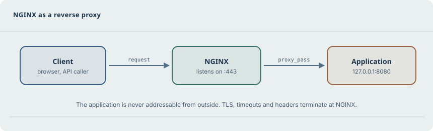
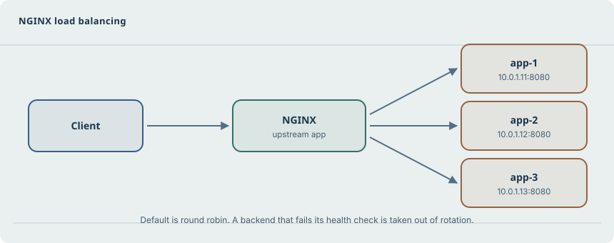
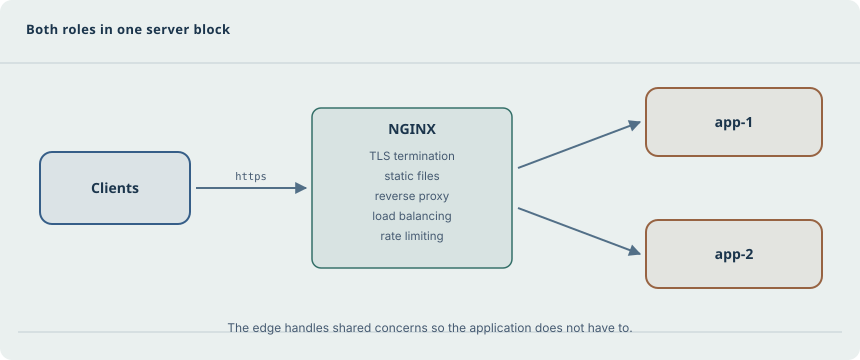

NGINX is a widely used web server and proxy but often isn't well understood by the teams using it. It gets added to the stack, it works, and nobody looks at it again until something breaks.

This is a practical walkthrough of what NGINX actually does and how to configure it for the two most common use cases: reverse proxy and load balancing.

## What NGINX is doing

At its core, NGINX is a web server with a non-blocking, event-driven architecture. Unlike older web servers that spawned a new thread or process per connection, NGINX handles thousands of concurrent connections with a small, fixed number of worker processes.

That architecture is why NGINX is ubiquitous — it's efficient enough to handle high-traffic scenarios without requiring large amounts of memory or a fleet of servers.

The two roles it plays most often:



**Reverse proxy** — sits between clients and your application servers. Clients talk to NGINX; NGINX forwards requests to your backend and returns the response. The client never directly connects to your application.

**Load balancer** — when you have multiple backend servers, NGINX distributes incoming requests across them, distributing work according to configured policy; capacity and overload controls remain necessary.



## Setting up NGINX as a reverse proxy

The basic configuration is straightforward. Here's a minimal reverse proxy that forwards HTTP requests to an application running on port 3000:

```nginx
server {
    listen 80;
    server_name yourdomain.com;

    location / {
        proxy_pass http://localhost:3000;
        proxy_http_version 1.1;

        # Forward client information to the backend
        proxy_set_header Host $host;
        proxy_set_header X-Real-IP $remote_addr;
        proxy_set_header X-Forwarded-For $proxy_add_x_forwarded_for;
        proxy_set_header X-Forwarded-Proto $scheme;
    }
}
```

A few things worth understanding in this config:

`proxy_http_version 1.1` — selects the upstream HTTP version for these examples. Traditional WebSocket upgrade proxying also needs appropriate Upgrade and Connection headers; this minimal configuration is not a complete WebSocket proxy. Defaults vary by NGINX version; set the intended upstream HTTP version explicitly and configure connection reuse separately.

`X-Real-IP` and `X-Forwarded-For` — your backend application will see NGINX's IP as the client IP without these headers. These headers carry address information, but the application must trust only approved proxies and handle client-supplied values safely.

`X-Forwarded-Proto` — here reports the scheme observed by NGINX. If another TLS terminator precedes it, the original scheme needs an explicit trusted-proxy design.

## Adding SSL termination

NGINX can terminate TLS at the proxy layer. The backend connection is a separate security decision; use verified upstream TLS when the threat model and deployment require it.

```nginx
server {
    listen 443 ssl;
    server_name yourdomain.com;

    ssl_certificate /etc/ssl/certs/yourdomain.crt;
    ssl_certificate_key /etc/ssl/private/yourdomain.key;
    
    # Modern TLS config
    ssl_protocols TLSv1.2 TLSv1.3;
    ssl_ciphers ECDHE-ECDSA-AES128-GCM-SHA256:ECDHE-RSA-AES128-GCM-SHA256;
    ssl_prefer_server_ciphers off;

    location / {
        proxy_pass http://localhost:3000;
        proxy_set_header Host $host;
        proxy_set_header X-Real-IP $remote_addr;
        proxy_set_header X-Forwarded-For $proxy_add_x_forwarded_for;
        proxy_set_header X-Forwarded-Proto https;
    }
}

## Redirect HTTP to HTTPS
server {
    listen 80;
    server_name yourdomain.com;
    return 301 https://$server_name$request_uri;
}
```

Certbot with Let's Encrypt is one option for certificate automation; other public and private CA workflows may fit the deployment. Certbot can write this config for you — but understanding what it generates helps when things break.

## Load balancing configuration



When you have multiple backend servers, define an `upstream` block:

```nginx
upstream backend_servers {
    server 10.0.1.10:3000;
    server 10.0.1.11:3000;
    server 10.0.1.12:3000;
}

server {
    listen 80;
    server_name yourdomain.com;

    location / {
        proxy_pass http://backend_servers;
        proxy_set_header Host $host;
        proxy_set_header X-Real-IP $remote_addr;
        proxy_set_header X-Forwarded-For $proxy_add_x_forwarded_for;
    }
}
```

The default upstream method uses weighted round-robin. Observed order and short-window counts can vary with worker state, server availability, and connection behavior.

## Load balancing algorithms

NGINX supports several algorithms via the `upstream` block:

**Weighted round-robin (default)** — distributes requests according to configured weights among eligible servers. Equal weights target equal shares under comparable conditions.

**Least connections** — considers active connections and configured weights. It may help with uneven request durations, but measure workload behavior before choosing it.

```nginx
upstream backend_servers {
    least_conn;
    server 10.0.1.10:3000;
    server 10.0.1.11:3000;
    server 10.0.1.12:3000;
}
```

**IP hash** — the same client IP tends to select the same backend while the available upstream set and configuration remain stable. Useful for stateful applications where session data is stored locally rather than in a shared store.

```nginx
upstream backend_servers {
    ip_hash;
    server 10.0.1.10:3000;
    server 10.0.1.11:3000;
}
```

**Weighted** — send more traffic to more capable servers.

```nginx
upstream backend_servers {
    server 10.0.1.10:3000 weight=3;  # Targets a 3:1 weighted share while both servers are eligible
    server 10.0.1.11:3000 weight=1;
}
```

## Health checks and failover

NGINX Open Source does passive health checking — it marks a server as down when requests to it fail, and stops sending traffic there. The parameters:

```nginx
upstream backend_servers {
    server 10.0.1.10:3000 max_fails=3 fail_timeout=30s;
    server 10.0.1.11:3000 max_fails=3 fail_timeout=30s;
    server 10.0.1.12:3000 backup;  # Only used when others are down
}
```

`max_fails=3` — use three qualifying unsuccessful attempts within fail_timeout to mark the server unavailable  
`fail_timeout=30s` — the failure-counting window and the period the server is considered unavailable  
`backup` — standby server, only receives traffic when all primary servers are down

The built-in HTTP active health-check module is a commercial NGINX Plus feature. An open-source deployment can use passive checks or a separately designed external controller; do not imply that an external probe automatically changes upstream routing.

## Rate limiting

One of NGINX's more useful features for protecting backends:

```nginx
## Define a rate limit zone: 10 requests/second per IP, 10MB memory for tracking
limit_req_zone $binary_remote_addr zone=api_limit:10m rate=10r/s;

server {
    location /api/ {
        limit_req zone=api_limit burst=20 nodelay;
        limit_req_status 429;
        proxy_pass http://backend_servers;
    }
}
```

`burst=20` — provides excess-request capacity; rejection uses 429 here because limit_req_status is set explicitly (the module default is 503)  
`nodelay` — processes burst requests immediately rather than queuing them

## Things that trip people up

**Timeouts.** Choose timeouts from the request budget and failure behavior rather than increasing them indiscriminately. If you're seeing intermittent 504s, check these:

```nginx
proxy_connect_timeout 60s;
proxy_send_timeout 60s;
proxy_read_timeout 60s;
```

**Buffer sizes.** NGINX buffers responses from backends before sending to clients. Large response bodies may spill to temporary files under buffering; large upstream headers can instead cause a header-buffer error. Diagnose the actual error before changing sizes:

```nginx
proxy_buffer_size 16k;
proxy_buffers 4 16k;
proxy_busy_buffers_size 32k;
```

**URI replacement.** In the ordinary prefix-location examples below, a proxy_pass URI replaces the matched normalized location prefix. Without a URI, the original or changed request URI is forwarded according to the documented rules. Regex locations, variables, and rewrite directives require separate handling. This causes subtle routing bugs that take time to diagnose.

```nginx
## These behave differently:
location /api/ { proxy_pass http://backend/; }   # /api/users → /users
location /api/ { proxy_pass http://backend; }     # /api/users → /api/users
```

NGINX rewards investment in understanding it. The configuration is declarative and logical once you have the mental model, and a well-configured NGINX is remarkably stable — it's one of those tools where you set it up correctly once and it quietly keeps working.

*Running into a specific NGINX configuration issue? [Reach out](/about) — happy to help think through it.*

## Treat the proxy as a boundary with two connections

A reverse proxy terminates one connection and creates another toward the upstream. Client-side TLS settings do not automatically secure the upstream connection. If the backend uses HTTPS, configure the relevant trust and hostname verification settings and test certificate rotation. If it uses a local Unix socket or loopback connection, document that scope. “Internal” is not a complete threat model.

The proxy also creates a trust boundary for headers. A client can send its own X-Forwarded-For value. Appending an address produces a chain, not a magically authenticated client identity. Configure the application to trust only known proxy hops, or overwrite the header at the appropriate trusted edge according to the architecture. If another load balancer precedes NGINX, configure real-client-address handling only for that trusted source range.

Host and scheme handling affect redirects, absolute URLs, and security decisions. Test the values the application actually receives through the full path. A proxy behind another TLS terminator may see an HTTP connection even though the original client used HTTPS. Do not trust an arbitrary forwarded-protocol header from the public internet to resolve that difference.

## Worked example: weighted routing is a traffic allocation

Consider two hypothetical healthy upstreams with weights three and one. Across an idealized steady sample of four hundred comparable requests, the intended proportion is three quarters and one quarter: three hundred requests to the first server and one hundred to the second. The chart shows those counts. It is a synthetic allocation example, not a guarantee for every short interval or a performance benchmark.

Weights do not establish capacity automatically. If the first server can handle twice as much work, assigning three times the traffic may overload it. Request cost can also vary: one expensive report is not equivalent to one cached read. Observe upstream latency, active work, errors, and resource use under a representative mix before choosing weights or a balancing method.

Failure and connection reuse can alter the observed distribution. A backend marked unavailable receives different treatment, and persistent connections or other balancing features affect routing behavior. Record the algorithm, upstream configuration, worker model, and sample window when interpreting a traffic chart. A distribution that differs from the simple ratio is a diagnostic question, not immediate proof of a bug.

## Timeout directives do not all define a total deadline

proxy_connect_timeout concerns establishing the upstream connection. proxy_send_timeout and proxy_read_timeout apply between successive write or read operations, not necessarily to the entire request or response duration. A slowly streaming response can continue longer than the read-timeout value if data keeps arriving within the interval. An application-level request deadline may still be necessary.

Choose a coherent budget across client, proxy, application, and dependencies. If the client gives up before the application stops work, retries can create duplicate load. If the proxy waits much longer than the business operation is useful, it can retain connections without improving the outcome. Document what happens to upstream work when the client disconnects and test that behavior for expensive operations.

Retry configuration deserves special care for requests with side effects. A connection failure can leave uncertainty about whether an upstream processed the request. Do not enable broad retries of non-idempotent operations without an application-level contract such as an idempotency key. Bound retry count and elapsed retry budget so a failing backend does not multiply load across the remaining healthy servers.

## Buffering, streaming, and body limits are separate choices

Response buffering can let NGINX receive upstream data and serve it to a slower client, using memory and potentially temporary files. A large body does not inherently produce a partial response because it exceeds one buffer. Large response headers are a different concern and can trigger header-related errors. Inspect the error log and upstream behavior before increasing memory allocations.

Streaming responses and server-sent events may require a different buffering strategy from ordinary JSON responses. Test time to first data, inter-message delay, connection lifetime, and behavior through every proxy in the path. Turning buffering off changes how slow clients influence upstream connections. It should be a workload-specific decision, not a universal performance tweak.

Set request-body limits and upload behavior deliberately. A large upload can consume disk, memory, network, and upstream capacity. Decide whether the proxy buffers the body before forwarding it and how timeouts apply. Return a useful error when a request exceeds the supported size. The application should enforce its own semantic limits too; the proxy's byte cap does not validate the content.

## Health checks and rate limits need observable semantics

Passive health checking reacts to qualifying unsuccessful attempts according to the upstream and next-upstream configuration. max_fails and fail_timeout work together, and a single-server upstream has special behavior described in the documentation. A server returning a business-level error may not be treated like a failed connection. Test the precise failure you intend the proxy to detect.

Active checks, where available in the selected product or external controller, should probe a meaningful readiness condition without making the check itself expensive. A health endpoint that always returns success can keep a broken service in rotation. A check that depends on every downstream system can instead remove all instances during a shared dependency outage. Choose the readiness contract carefully.

Rate limiting is keyed by the configured value. An IP-based key can group many users behind one NAT, while a user-provided header can be forged unless authenticated by a trusted layer. The module's default rejection status is 503; set limit_req_status 429 explicitly when that matches the API contract. Test burst behavior and monitor rejected requests before enforcing a new policy broadly.

## A local proxy lab

Run two harmless local HTTP backends on different loopback ports, each returning its identity. Create an isolated NGINX configuration with a nonprivileged listener and those upstreams. Validate the configuration using nginx -t with the intended config path. Send a fixed set of requests, record the responding backend, then stop one backend and observe the configured failover behavior.

Test a slow response, an oversized header, a body over the allowed limit, and a request path with and without the location prefix. Keep these cases separate so each observation has a clear cause. The proxy_pass URI replacement rules depend on the location and configuration form; the simple trailing-slash example does not cover regex locations, variables, or rewrite interactions.

Inspect both access and error logs. Include request time and relevant upstream timing fields in the lab's logging format, while avoiding sensitive payloads or credentials. A client-visible 504 can originate from different timeout conditions, and an upstream 502 can have several causes. Correlate the proxy evidence with the backend rather than diagnosing solely from the status code.

The practical takeaway is to validate the proxy's complete contract: routing, identity, trust, deadlines, retries, buffering, and overload behavior. A syntax-valid configuration is only the beginning. A small reproducible lab gives each directive an observable meaning before it becomes part of a production traffic path.

## Sources and further reading

- [NGINX · HTTP proxy module](https://nginx.org/en/docs/http/ngx_http_proxy_module.html)
- [NGINX · Upstream module](https://nginx.org/en/docs/http/ngx_http_upstream_module.html)
- [NGINX · Request limiting](https://nginx.org/en/docs/http/ngx_http_limit_req_module.html)
